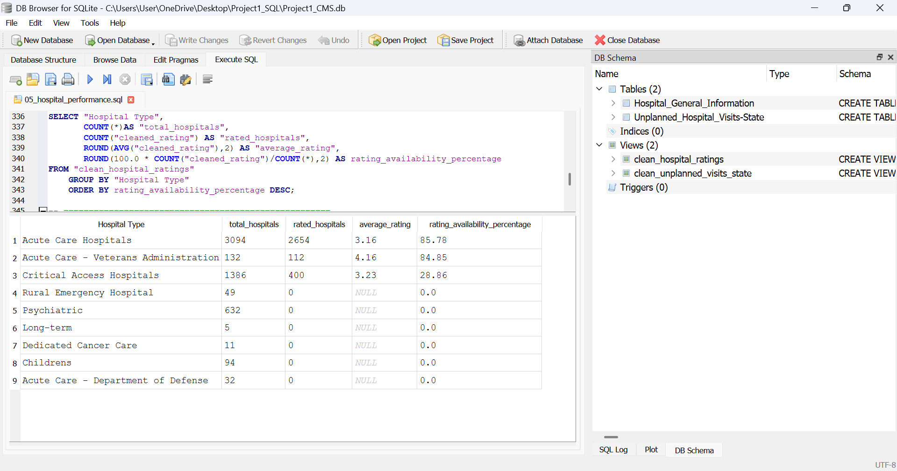
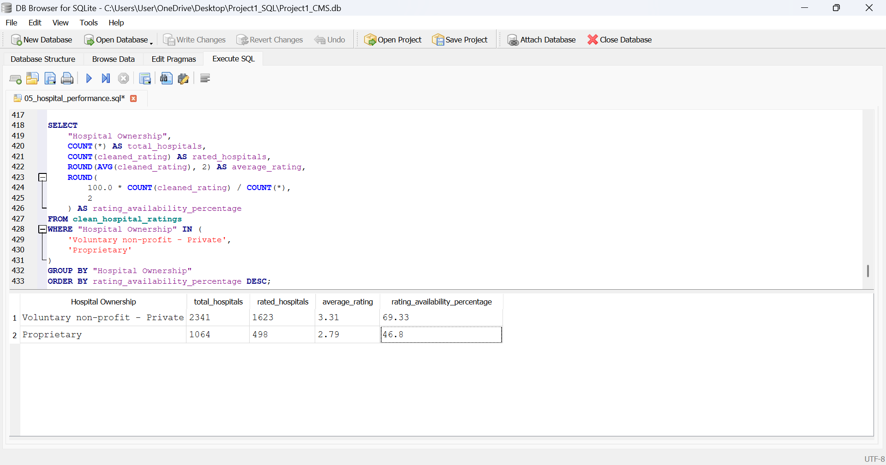
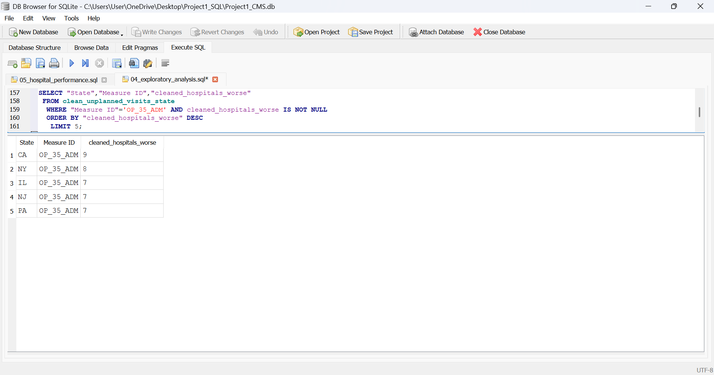
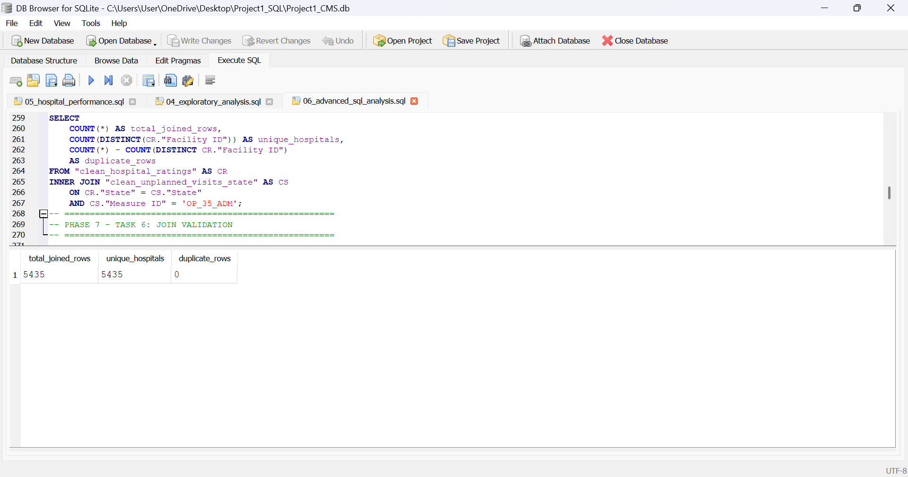

# 🏥 Healthcare SQL Analytics
### Hospital Quality, Rating Availability & Unplanned Hospital Visits

**A SQL-based healthcare data analytics project using publicly available CMS hospital data.**

## Project Overview

Healthcare performance data provides opportunities to identify patterns in hospital quality and reporting. However, meaningful analysis requires careful examination of data completeness, reporting eligibility, and differences between healthcare facilities.

This project investigates **5,435 hospital records** and **784 state-level performance records** published by the Centers for Medicare & Medicaid Services (CMS).

Using SQL and SQLite, the analysis examines hospital characteristics, CMS overall star ratings, reporting availability, geographic differences, and unplanned hospital visits following outpatient chemotherapy.

The project combines technical SQL analysis with clinical interpretation informed by experience in oncology and hematology nursing.

**Primary objective:** Produce transparent, reproducible healthcare insights while distinguishing observed associations from unsupported causal conclusions.

---

## Tools & Skills

| Category | Tools / Techniques |
|---|---|
| Database | SQLite |
| SQL Environment | DB Browser for SQLite |
| Data Cleaning | CASE, CAST, NULL handling, SQL Views |
| Exploratory Analysis | GROUP BY, COUNT, AVG, MIN, MAX |
| Advanced SQL | JOINs, CTEs, Subqueries, Window Functions |
| Data Validation | Duplicate checks, JOIN validation, missing-value investigation |
| Healthcare Analytics | CMS Quality Measures, Hospital Ratings, Clinical Interpretation |

---

## Data Sources

Two CMS datasets were used:

| Dataset | Records | Granularity |
|---|---:|---|
| Hospital General Information | 5,435 | Individual hospital |
| Unplanned Hospital Visits — State | 784 | State and measure |

**Official CMS sources:**

- [Hospital General Information](https://data.cms.gov/provider-data/dataset/xubh-q36u)
- [Unplanned Hospital Visits — State](https://data.cms.gov/provider-data/dataset/4gkm-5ypv)
- [CMS Overall Hospital Quality Star Rating](https://data.cms.gov/provider-data/topics/hospitals/overall-hospital-quality-star-rating)
- [CMS OP-35 Chemotherapy Measure](https://qualitynet.cms.gov/outpatient/measures/chemotherapy)

The analysis uses the original downloaded datasets, not necessarily the latest versions currently published by CMS.

Data-version note: The preserved CSV files are consistent with the CMS November 12, 2026 release. The OP_35_ADM and OP_35_ED measurement period is January 1–December 31, 2024. Other measures have different reporting periods, documented in docs/dataset_documentation.md. An exact file-hash comparison with the official archived downloads has not been performed.

---

## Project Workflow

The project followed a structured analytical process:

**1. Data Quality Assessment**

Investigated missing values, duplicate identifiers, numerical inconsistencies, reporting placeholders, and geographic-code consistency.

**2. Data Cleaning**

Created two reusable SQL views:

- `clean_hospital_ratings`
- `clean_unplanned_visits_state`

The views prepare numerical fields for analysis while preserving the original CMS tables.

**3. Exploratory Data Analysis**

Examined hospital distributions, ownership categories, geographic patterns, overall ratings, and state-level measure availability.

**4. Hospital Performance Analysis**

Compared published ratings and reporting coverage across hospital types, ownership categories, and states.

**5. Advanced SQL Analysis**

Applied JOINs, CASE expressions, CTEs, correlated subqueries, and validation queries to investigate relationships while avoiding misleading calculations.

**6. Healthcare Interpretation**

Evaluated the findings using clinical context, identified analytical limitations, and developed evidence-informed recommendations.

---

## Key Findings

### 1. Hospital Rating Availability

Of the 5,435 hospitals investigated:

- **3,166 hospitals (58.25%)** had available overall CMS ratings.
- **2,269 hospitals (41.75%)** lacked available overall ratings.

Rating availability varied substantially across hospital types.

| Hospital Type | Rating Availability |
|---|---:|
| Acute Care Hospitals | 85.78% |
| Veterans Administration | 84.85% |
| Critical Access Hospitals | 28.86% |

**Key insight:** Performance comparisons must consider how many hospitals are represented. An unavailable rating does not necessarily indicate poor clinical performance.



### 2. Hospital Ownership and Performance

A comparison of two major ownership categories revealed:

| Indicator | Private Nonprofit | Proprietary |
|---|---:|---:|
| Total Hospitals | 2,341 | 1,064 |
| Rated Hospitals | 1,623 | 498 |
| Average Rating | 3.31 | 2.79 |
| Rating Availability | 69.33% | 46.80% |

Privately owned voluntary nonprofit hospitals had higher average published ratings and greater rating availability.

However, these differences do not establish that ownership causes better or worse healthcare outcomes.

Potential confounding factors include hospital type, patient populations, available services, geography, and reporting eligibility.

**Key insight:** Descriptive associations should not be presented as causal relationships.



### 3. Geographic Differences

Among states with at least 30 rated hospitals, the highest observed average ratings included:

| State | Rated Hospitals | Average Rating |
|---|---:|---:|
| Colorado | 49 | 3.96 |
| Wisconsin | 86 | 3.78 |
| Minnesota | 56 | 3.77 |
| Virginia | 76 | 3.68 |
| Ohio | 127 | 3.59 |

The 30-hospital threshold was selected for exploratory comparison and is not an official CMS methodology requirement.

These averages describe the available ratings and should not be interpreted as comprehensive rankings of statewide healthcare quality.

### 4. Oncology-Related Unplanned Hospital Visits

The analysis investigated **OP_35_ADM**, a CMS measure related to inpatient admissions following outpatient chemotherapy.

Selected state-level counts of hospitals classified as performing worse included:

| State | Hospitals Classified as Worse |
|---|---:|
| California | 9 |
| New York | 8 |
| Illinois | 7 |
| New Jersey | 7 |
| Pennsylvania | 7 |

These results represent state-level, measure-specific hospital counts—not individual patient admissions.

They may inform further quality-improvement investigation but cannot establish the causes of unplanned admissions.

**Clinical relevance:** Potential areas for further investigation include treatment-related complications, symptom management, supportive care, patient education, and post-treatment follow-up.



---

## Technical Highlight: JOIN Validation

One of the project's main technical challenges was combining hospital-level records with state-level performance measures.

Because the datasets have different levels of granularity, an unrestricted JOIN could multiply hospital rows and produce misleading calculations.

The analysis restricted the relevant JOIN to the OP_35_ADM measure and validated its output.

| Validation Metric | Result |
|---|---:|
| Total Joined Rows | 5,435 |
| Distinct Hospital IDs | 5,435 |
| Excess Rows | 0 |

**Result:** The validated JOIN preserved all 5,435 hospital records without duplicating hospital identifiers.

This does not mean state-level performance counts can be attributed to individual hospitals.



---

## Project Structure

```text
Healthcare-SQL-Analytics/
│
├── README.md
│
├── sql/
│   ├── 01_data_exploration.sql
│   ├── 02_data_quality.sql
│   ├── 03_data_cleaning.sql
│   ├── 04_exploratory_analysis.sql
│   ├── 05_hospital_performance.sql
│   └── 06_advanced_sql_analysis.sql
│
├── data/
│   └── raw/
│       └── Original CMS CSV files
│
├── docs/
│   ├── cleaning_methodology.md
│   └── exploratory_performance_analysis.md
│
├── reports/
│   └── final_findings_report.md
│
└── screenshots/
    ├── 01_rating_availability.png
    ├── 02_ratings_by_ownership.png
    ├── 03_ownership_rating_availability.png
    ├── 04_OP35_ADM_state_analysis.png
    └── 05_join_validation.png
```

### Detailed Documentation

- [Data Cleaning Methodology](docs/cleaning_methodology.md)
- [Exploratory and Performance Analysis](docs/exploratory_performance_analysis.md)
- [Comprehensive Findings Report](reports/final_findings_report.md)

---

## Reproducing the Analysis

The project was developed using SQLite and DB Browser for SQLite.

To reproduce the analysis:

1. Obtain the original CMS CSV files from the project's `data/raw` folder.
2. Import them into a SQLite database using the following table names:
   - `Hospital_General_Information`
   - `Unplanned_Hospital_Visits-State`
3. When importing the CSV files into DB Browser for SQLite, enable "Disable data type detection" to preserve Facility IDs and ZIP codes as text, including leading zeros. Keep the original column names unchanged.
4. Execute the initial exploration and data quality scripts:
   - `sql/01_data_exploration.sql`
   - `sql/02_data_quality.sql`
5. Execute the cleaning script to create the cleaned views:
   - `sql/03_data_cleaning.sql`
6. Execute the remaining analysis scripts in order:
   - `sql/04_exploratory_analysis.sql`
   - `sql/05_hospital_performance.sql`
   - `sql/06_advanced_sql_analysis.sql`
7. Compare the outputs against the documented findings and screenshots.

The cleaning script creates views and should be executed against a database in which those views do not already exist, unless the script has been adapted for repeated execution.

**Reproducibility status:** All six SQL scripts were successfully executed against a fresh SQLite database reconstructed from the preserved CMS CSV files. The principal analytical findings were reproduced.

---

## Limitations

The analysis has several important limitations:

- Overall star ratings were unavailable for 41.75% of hospital records.
- CMS reporting eligibility may differ between hospital categories.
- Hospital type and ownership comparisons do not control for all potentially relevant characteristics.
- State-level performance measures cannot identify individual hospital outcomes.
- Descriptive analysis cannot independently establish causation.
- CMS overall star ratings summarize multiple quality dimensions and should not be treated as direct measurements of individual patient outcomes.
- The preserved datasets are consistent with the CMS November 12, 2026 release. Measure-specific reporting periods are documented in docs/dataset_documentation.md. Exact file identity against archived CMS downloads has not been independently verified.

These limitations are essential to interpreting the findings responsibly.

---

## Recommendations

The analysis supports four recommendations:

1. **Improve reporting transparency:** Present average ratings alongside the number and percentage of hospitals with available ratings.
2. **Use comparable hospital groups:** Investigate performance differences while considering eligibility, hospital characteristics, and potential confounding factors.
3. **Investigate oncology-related unplanned visits:** Use more detailed hospital-level and patient-level evidence to examine potential quality-improvement opportunities.
4. **Maintain SQL validation procedures:** Verify identifiers, missing values, JOIN cardinality, and aggregation logic before reporting findings.

---

## Conclusion

This project demonstrates the application of SQL to real-world healthcare data, from initial data-quality assessment through cleaning, exploratory analysis, performance evaluation, and clinical interpretation.

Its most important finding is that **published hospital performance statistics must be interpreted alongside data availability, reporting eligibility, and the limitations of the underlying datasets**.

The project also demonstrates the importance of validating SQL transformations and avoiding unsupported causal claims.

By combining analytical techniques with a clinical nursing perspective, this project illustrates an approach to healthcare analytics focused on accuracy, transparency, and responsible interpretation.

---

## About the Project

Developed as an independent healthcare data analytics portfolio project by a registered nurse transitioning into healthcare data analytics.

The project demonstrates practical SQL skills alongside healthcare domain knowledge and an emphasis on evidence-informed analysis.

**Data attribution:** Centers for Medicare & Medicaid Services (CMS).

*This is an independent educational project and is not affiliated with or endorsed by CMS.*